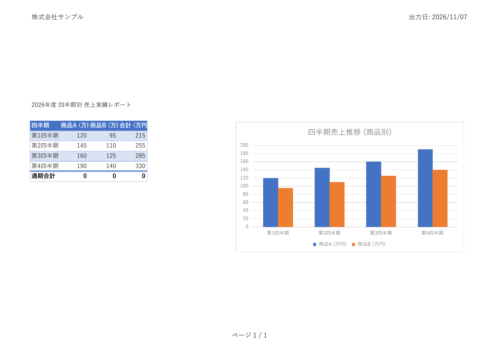

# osbxl サンプル集 (osbxl-samples)

> **最終更新日: 2026年11月8日**（osbxl `v2.0.1` 最新実測値反映）  
> [English README is available here](README.md)

**[osbxl 公式サイト (https://osb-office.com)](https://osb-office.com/)** の公式サンプルコード・パターン集です。  
osbxl は、AI によるコード自動生成に対応した、C++ 製コアによる超高速マルチプラットフォーム・スプレッドシート計算＆Excel 生成エンジンです。

[](https://osb-office.com/)
[](https://osb-office.com/pages/comparison.php)
[](https://osb-office.com/pages/ai-skill.php)
[](https://osb-office.com/pages/features.php)

---

## 📊 主要Excelライブラリとの違い・性能比較

> 📈 **[最新！マルチプラットフォーム総合実測負荷テスト レポート (v2.0.1)](benchmarks/BENCHMARK_REPORT_3OS.md)**: クラウド（GCP C3/C4）・macOS（Apple M4）・Windows 11における徹底検証。従来のライブラリが OOM で落ちる 50,000行を osbxl がわずか 0.1〜0.5秒で安全完走する詳細データを公開中。
> 
> **詳細な比較表・移行ガイドは [公式サイトのライブラリ比較ページ](https://osb-office.com/pages/comparison.php) をご覧ください。**

従来の高級言語ライブラリ（Apache POI、openpyxl、PhpSpreadsheet 等）で大量データを扱う際の**「メモリ不足（Memory Exhausted）」「GC による速度低下」「計算エンジンの不在」**を、C++ ネイティブコアにより根本から解決します。

| 項目 | **osbxl** | **Apache POI (Java)** | **openpyxl (Python)** | **PhpSpreadsheet (PHP)** | **SheetJS / ExcelJS (JS)** |
| :--- | :--- | :--- | :--- | :--- | :--- |
| **コア実装** | **C++ ネイティブ** | Java | Python | PHP | JavaScript |
| **大量データ処理** | **◎ 圧倒的に高速** | ◯ (SXSSFストリーム) | △ (行数増加で遅延) | ✕ (数万行で極めて遅い) | ◯ / △ |
| **メモリ消費** | **◎ 最小限（最大90%削減）** | △ (ヒープ大量消費) | △ (オブジェクト過多) | ✕ (メモリ制限で500エラー) | △ (V8ヒープ制限) |
| **Excel計算式評価** | **約500関数（XLOOKUP等）** | 300〜400関数 | ✕ (数式評価不可) | △ (一部のみ・重い) | 限定的 / 有償版 |
| **AIコード生成** | **◎ 公式AI Skill同梱** | なし (ハルシネーション頻発)| なし | なし | なし |
| **WebAssembly** | **◎ 公式対応 (Wasm 3.0)** | ✕ | △ (巨大ランタイム要) | ✕ | ◯ |

---

## 🌟 主な特徴

- **🤖 AIコーディング完全対応（ハルシネーション・嘘のコードゼロ）**:  
  **Cursor / GitHub Copilot / Gemini / Claude Code** 向けの公式 AI Skill パッケージを同梱。AI が厳格な API 仕様や落とし穴（Pitfalls）を自動認識し、1発で正常動作する Excel 操作コードを自動生成します。
- **⚡ C++ コアによる圧倒的な計算速度**:  
  ネイティブ C++ エンジンにより、大規模ワークブックや複雑な数式計算もミリ秒単位で超高速処理。メモリ消費も最小限に抑えます。
- **🌐 5つのプラットフォームにネイティブ対応**:  
  **Python (pyosbxl)** / **Node.js (nodeosbxl)** / **Java (osbxl)** / **PHP (phposbxl)** / **WebAssembly (wasmosbxl)** で共通の直感的な API 設計。
- **📊 充実した Excel 互換機能**:  
  Excel 互換の 500 に近い関数、グラフ・チャート（縦棒・折れ線等）、オートフィルター、テーブル（ListObjects・集計行）、条件付き書式、ピボットテーブルをサポート。
- **🔒 セキュリティ**:  
  パスワード付き・暗号化された `.xlsx` ファイルの読み込みおよび生成に対応。
- **📄 高速・直接 PDF 出力 (v2.0.0 新機能)**:  
  Excel ファイルを一時保存することなく、メモリバッファから直接 PDF を出力（`saveAsPdf` / `saveAsPdfToBuffer`）。Web API や Express 等でファイル I/O なしに直接 HTTP レスポンスとしてストリーミング配信可能です。

---

## 📁 ディレクトリ構成

```text
osbxl-samples/
├── README.md               # 英語版 README (English)
├── README.ja.md            # 日本語版 README (本ファイル)
├── LICENSE                 # ライセンス条項 (英語版)
├── LICENSE.ja.md           # ライセンス条項 (日本語版)
├── examples/               # 実行可能コードサンプル (全言語 01〜12章 網羅 & zeroBase 準拠)
│   ├── nodejs/             # Node.js サンプル
│   │   ├── 01_overview.js 〜 12_pdf_export.js
│   │   ├── 13_express_pdf_stream.js  # [注目] Express によるインメモリ PDF 直接ストリーミング
│   │   └── README.md                 # Express PDF サーバーの起動・curl 検証手順
│   ├── python/             # Python サンプル
│   │   ├── 01_overview.py 〜 12_pdf_export.py
│   │   ├── 13_fastapi_pdf_stream.py  # [注目] FastAPI によるインメモリ PDF 直接ストリーミング
│   │   └── README.md                 # FastAPI PDF サーバーの起動・curl 検証手順
│   ├── php/                # PHP サンプル
│   │   ├── 01_overview.php 〜 12_pdf_export.php
│   │   ├── 13_slim_pdf_stream.php    # [注目] Slim 4 によるインメモリ PDF 直接ストリーミング
│   │   └── README.md                 # Slim 4 PDF サーバーの起動・curl 検証手順
│   ├── java/               # Java サンプル
│   │   ├── General01Overview.java 〜 General12PdfExport.java
│   │   ├── spring-boot-pdf/          # [注目] Spring Boot によるインメモリ PDF 直接ストリーミング
│   │   └── README.md                 # Spring Boot PDF サーバーのビルド・起動・curl 検証手順
│   └── wasm/               # WebAssembly サンプル (01_overview.wasm.js 〜 12_pdf_export.wasm.js)
├── ja/                     # 日本語版 Web 形式リファレンス (general-01 ~ 12)
└── en/                     # 英語版 Web 形式リファレンス (general-01 ~ 12)
```

### 🌟 注目の実践サンプル: Web API によるメモリ直接 PDF 配信 (v2.0.1)

バージョン 2.0.1 の **PDF 直接ストリーミング** の実践例です。  
一時ファイルを作らず、`wb.saveAsPdfToBuffer()` で取得したバイナリデータを HTTP POST レスポンスに直接パイプしてクライアントへ即時返却します。

- **Node.js (Express)**:
  - 👉 **[Express PDF 直接ストリーミング解説 (examples/nodejs/README.md)](examples/nodejs/README.md)**  
  - 👉 **ソースコード: [`examples/nodejs/13_express_pdf_stream.js`](examples/nodejs/13_express_pdf_stream.js)**
- **Python (FastAPI)**:
  - 👉 **[FastAPI PDF 直接ストリーミング解説 (examples/python/README.md)](examples/python/README.md)**  
  - 👉 **ソースコード: [`examples/python/13_fastapi_pdf_stream.py`](examples/python/13_fastapi_pdf_stream.py)**
- **PHP (Slim 4)**:
  - 👉 **[Slim 4 PDF 直接ストリーミング解説 (examples/php/README.md)](examples/php/README.md)**  
  - 👉 **ソースコード: [`examples/php/13_slim_pdf_stream.php`](examples/php/13_slim_pdf_stream.php)**
- **Java (Spring Boot)**:
  - 👉 **[Spring Boot PDF 直接ストリーミング解説 (examples/java/README.md)](examples/java/README.md)**  
  - 👉 **プロジェクト: [`examples/java/spring-boot-pdf/`](examples/java/spring-boot-pdf/)**

---

## 📊 ライブラリ別 総合機能比較 ＆ 実測パフォーマンス

**最終更新日: 2026/10/18**

実務のExcel自動生成で重要となる高度な機能（数式評価、ピボットテーブル、チャート、パスワード暗号化など）について、オープンソース主要ライブラリと **osbxl** の対応状況および実測性能です。

### 1. 機能対応マトリクス

| 機能項目 | osbxl (5言語共通) | Apache POI (Java) | openpyxl (Python) | PhpSpreadsheet (PHP) | ExcelJS / SheetJS (JS) |
|---|:---:|:---:|:---:|:---:|:---:|
| **.xlsx 読み書き** | **◎ 高速・安定** | **◎** | **◎** | **◎** | **◎** |
| **サーバーサイド数式評価**<br>(Excel非インストール環境での値計算) | **◎ 約500関数**<br>(XLOOKUP等含む) | **◯ 300〜400関数**<br>(Evaluator) | **✕ 非対応**<br>(Excel起動までNone) | **△ 一部のみ**<br>(重厚・関数限定) | **✕ 非対応**<br>(SheetJS無償版不可) |
| **テーブル / 構造化参照**<br>(`SUM(Table[列名])` 等) | **◎ 完全対応・ネイティブ評価** | **△ 計算不可**<br>(保存のみ) | **✕ 評価不可** | **✕ 評価不可** | **✕ 評価不可** |
| **オートフィルター** | **◎ 高度フィルター対応** | **◯** | **◯** | **◯** | **◯** |
| **ピボットテーブル作成** | **◎ 標準API対応** | **◯ 低レイヤXML** | **△ 読み取り中心** | **✕ 非対応** | **✕ 非対応** |
| **チャート・グラフ生成** | **◎ 2D / 3D 多数** | **◯ XDDF経由** | **◯ 2D/3D対応** | **△ 描画制約あり** | **✕〜△ 限定的** |
| **パスワード暗号化 / 復号** | **◎ ビルトイン対応** | **◯ 標準対応** | **✕ 外部ツール要** | **✕ 拡張モジュール要** | **✕ 非対応** |
| **コメント (新旧スレッド/メモ)** | **◎ スレッド・メモ両対応** | **◯ メモ対応** | **◯ コメント対応** | **◯ コメント対応** | **◯ コメント対応** |
| **AIコード生成最適化** | **◎ 専用AI Skill提供**<br>(捏造・ハルシネーション0) | **✕ 非公式**<br>(架空API誤生成多発) | **✕ 非公式** | **✕ 非公式** | **✕ 非公式** |

### 2. 実務の標準規模「200行（800セル）」実測ベンチマーク

業務システムで最も頻出する帳票サイズ（**200行 × 4列 = 計800セル + SUM総合計数式**）の実測比較です。

| 言語 | 比較対象ライブラリ | GCP C4: 相手方OSS | GCP C4: **osbxl** | macOS: 相手方OSS | macOS: **osbxl** | 高速化倍率 |
| :--- | :--- | :---: | :---: | :---: | :---: | :---: |
| **PHP** (8.5) | PhpSpreadsheet vs **phposbxl** | 0.017 秒 | **0.007 秒** | 0.018 秒 | **0.005 秒** | **2.4 〜 3.5 倍** |
| **Python** (3.14) | openpyxl vs **pyosbxl** (`setOnlyMode`) | 0.011 秒 | **0.007 秒** | 0.005 秒 | **0.003 秒** | **約 1.7 倍** |
| **Node.js** (v24) | ExcelJS vs **nodeosbxl** (`setOnlyMode`) | 0.011 秒 | **0.008 秒** | 0.005 秒 | **0.004 秒** | **1.3 〜 1.5 倍** |
| **Java** (JDK 24/8) | Apache POI vs **osbxl (Java)** | 0.542 秒 | **0.110 秒** | 0.311 秒 | **0.057 秒** | **4.9 〜 5.5 倍** |

### 3. 中規模データ「10,000行（40,000セル）」実測ベンチマーク

月次レポートや各種台帳出力など、実務の業務システムで多用される中規模帳票（**10,000行 × 4列 = 計40,000セル + SUM総合計数式**）の実測比較です。

| 言語 | 比較対象ライブラリ | GCP C4: 相手方OSS | GCP C4: **osbxl** | macOS: 相手方OSS | macOS: **osbxl** | 高速化倍率 |
| :--- | :--- | :---: | :---: | :---: | :---: | :---: |
| **PHP** (8.5) | PhpSpreadsheet vs **phposbxl** | 0.760 秒 | **0.055 秒** | 0.862 秒 | **0.037 秒** | **13.9 〜 23.4 倍** |
| **Python** (3.14) | openpyxl vs **pyosbxl** (`setOnlyMode`) | 0.324 秒 | **0.058 秒** | 0.166 秒 | **0.030 秒** | **5.5 倍** |
| **Node.js** (v24) | ExcelJS vs **nodeosbxl** (`setOnlyMode`) | 0.239 秒 | **0.056 秒** | 0.109 秒 | **0.028 秒** | **3.9 〜 4.3 倍** |
| **Java** (JDK 24/8) | Apache POI vs **osbxl (Java)** | 1.335 秒 | **0.208 秒** | 0.620 秒 | **0.098 秒** | **6.3 〜 6.4 倍** |

### 4. 大規模データ限界負荷テスト「50,000行（200,000セル）」実測

データ規模を **50,000行 × 4列 = 計200,000セル＋SUM集計** まで拡大した限界テスト結果です。既存ライブラリがメモリ枯渇（OOM）でクラッシュする中、osbxl は全環境・全言語で完走します。

| 言語 / 環境 | 比較対象ライブラリ | GCP C4: 相手方OSS | GCP C4: **osbxl** | macOS: 相手方OSS | macOS: **osbxl** | 特徴・検証結果 |
| :--- | :--- | :---: | :---: | :---: | :---: | :--- |
| **PHP** (8.5 / 128M) | PhpSpreadsheet vs **phposbxl** | ❌ OOMクラッシュ | **0.346 秒** | ❌ OOMクラッシュ | **0.189 秒** | **相手方はメモリ上限超過で異常終了**。<br>phposbxl はわずか 32MB・0.1〜0.3秒台で余裕の安全完走。 |
| **Python** (3.14) | openpyxl vs **pyosbxl** (`setOnlyMode`) | 1.662 秒 | **0.378 秒** | 0.850 秒 | **0.183 秒** | **C4で 4.39倍、M4で 4.64倍 高速**。<br>Python ヒープ消費はわずか 28MB で OOM の危険ゼロ。 |
| **Node.js** (v24) | ExcelJS vs **nodeosbxl** (`setOnlyMode`) | 0.979 秒 | **0.329 秒** | 0.502 秒 | **0.133 秒** | **C4で 2.97倍、M4で 3.77倍 高速**。<br>V8 ヒープ消費を 20.9MB に抑制し並行処理に最適。 |
| **Java** (JDK 24/8 / 256M) | Apache POI vs **osbxl (Java)** | ❌ OOMクラッシュ | **0.553 秒** | ❌ OOMクラッシュ | **0.247 秒** | **POI はヒープ枯渇でクラッシュ**。<br>osbxl は 36MB の軽量ヒープ・0.2〜0.5秒台で完走。 |

> 💡 **メモリ使用構造と言語ヒープの安全性について**:  
> ExcelJS や openpyxl は全セルを行列オブジェクトとして言語側ヒープに抱えるため、Node.js や Python のヒープ上限を急速に圧迫します。<br>
> 一方、osbxl はデータを2次元配列から即座に C++ エンジンへ引き渡すため、**Node.js 側の V8 ヒープ消費は 50,000 行でもわずか 20.9 MB、Python 側も 28 MB** に抑えられ、言語ランタイムの OOM（ヒープ枯渇）クラッシュを起こしません。プロセス全体の Peak RSS は、20万セルの XML 並列生成と ZIP ストリーム圧縮バッファを C++ コアで高速処理するために一時的に確保されるネイティブ作業領域です。  
> 📖 **詳細な機能マトリクスと考察**: [Excelライブラリ 総合機能比較 ＆ ベンチマークレポート (ja/benchmark-comparison.md)](ja/benchmark-comparison.md) をご覧ください。

---

## 🚀 クイックコード例 (v2.0.1 メモリ直接 PDF 出力)

osbxl 2.0.1 の **インメモリ直接 PDF 出力 (`wb.saveAsPdfToBuffer`)** のコード例です。  
ディスク一時ファイル保存ゼロで、Web サーバーの HTTP レスポンス等へそのままパイプ・返却できます。  
（※全言語の実装や詳細オプションは、**[12章: PDF エクスポート (ja/general-12-pdf-export.md)](ja/general-12-pdf-export.md)** を参照してください）

### Node.js (Express)

```javascript
const express = require("express");
const { nodeosbxl, dto, enums } = require("nodeosbxl");

const app = express();

app.post("/api/export-pdf", (req, res) => {
    const xlApp = new nodeosbxl.App();
    const wb = xlApp.createWorkBook("report.xlsx");
    const ws = wb.openWorkSheet(0); // 0 始まり (zeroBase)

    ws.getRange("A1").setValue("2026年度 売上実績レポート");
    ws.getCells(1, 0).setValue("四半期");
    ws.getCells(1, 1).setValue("売上 (万円)");
    ws.getCells(2, 0).setValue("第1四半期");
    ws.getCells(2, 1).setNumberValue(150);
    ws.getCells(3, 0).setValue("第2四半期");
    ws.getCells(3, 1).setNumberValue(230);
    ws.getCells(4, 0).setValue("合計");
    ws.getCells(4, 1).setFormula("SUM(B3:B4)");

    // A4 横向き・中央揃え
    const ps = ws.getPageSetupObject();
    ps.setPaperSize(enums.XlPaperSize.PaperA4);
    ps.setOrientation(enums.XlPageOrientation.Landscape);
    ps.setCenterHorizontally(true);
    ws.setPageSetupObject(ps);

    // PDF オプション (閲覧パスワード暗号化 & 印刷許可)
    const pdfOpt = new dto.PdfExportObject();
    pdfOpt.setOpenPassword("customer2026");
    pdfOpt.setAllowPrint(true);

    // ディスク保存ゼロでメモリ直接 PDF 生成
    const pdfBuffer = wb.saveAsPdfToBuffer(false, ["Sheet1"], true, pdfOpt);
    wb.close();

    res.setHeader("Content-Type", "application/pdf");
    res.setHeader("Content-Disposition", 'attachment; filename="report.pdf"');
    res.send(pdfBuffer);
});

app.listen(3000);
```

### Python (FastAPI)

```python
from fastapi import FastAPI, Response
import pyosbxl
from pyosbxl import dto, enums

app = FastAPI()

@app.post("/api/export-pdf")
def export_pdf():
    xl_app = pyosbxl.App()
    wb = xl_app.createWorkBook("report.xlsx")
    ws = wb.openWorkSheet(0)  # 0 始まり (zeroBase)

    ws.getRange("A1").setValue("2026年度 売上実績レポート")
    ws.getCells(1, 0).setValue("四半期")
    ws.getCells(1, 1).setValue("売上 (万円)")
    ws.getCells(2, 0).setValue("第1四半期")
    ws.getCells(2, 1).setNumberValue(150)
    ws.getCells(3, 0).setValue("第2四半期")
    ws.getCells(3, 1).setNumberValue(230)
    ws.getCells(4, 0).setValue("合計")
    ws.getCells(4, 1).setFormula("SUM(B3:B4)")

    ps = ws.getPageSetupObject()
    ps.setPaperSize(enums.XlPaperSize.PaperA4)
    ps.setOrientation(enums.XlPageOrientation.Landscape)
    ps.setCenterHorizontally(True)
    ws.setPageSetupObject(ps)

    pdf_opt = dto.PdfExportObject()
    pdf_opt.setOpenPassword("customer2026")
    pdf_opt.setAllowPrint(True)

    # メモリから bytes を直接取得
    pdf_bytes = wb.saveAsPdfToBuffer(False, ["Sheet1"], True, pdf_opt)
    wb.close()

    return Response(
        content=pdf_bytes,
        media_type="application/pdf",
        headers={"Content-Disposition": 'attachment; filename="report.pdf"'}
    )
```

### PHP (Slim 4)

```php
use Psr\Http\Message\ResponseInterface as Response;
use Psr\Http\Message\ServerRequestInterface as Request;
use phposbxl\App;
use phposbxl\enums\XlPaperSize;
use phposbxl\enums\XlPageOrientation;
use phposbxl\dto\PdfExportObject;

$app->post('/api/export-pdf', function (Request $request, Response $response) {
    $xlApp = new App();
    $wb = $xlApp->createWorkBook("report.xlsx");
    $ws = $wb->openWorkSheet(0); // 0 始まり (zeroBase)

    $ws->getRange("A1")->setValue("2026年度 売上実績レポート");
    $ws->getCells(1, 0)->setValue("四半期");
    $ws->getCells(1, 1)->setValue("売上 (万円)");
    $ws->getCells(2, 0)->setValue("第1四半期");
    $ws->getCells(2, 1)->setNumberValue(150);
    $ws->getCells(3, 0)->setValue("第2四半期");
    $ws->getCells(3, 1)->setNumberValue(230);
    $ws->getCells(4, 0)->setValue("合計");
    $ws->getCells(4, 1)->setFormula("SUM(B3:B4)");

    $ps = $ws->getPageSetupObject();
    $ps->setPaperSize(XlPaperSize::PaperA4);
    $ps->setOrientation(XlPageOrientation::Landscape);
    $ps->setCenterHorizontally(true);
    $ws->setPageSetupObject($ps);

    $pdfOpt = new PdfExportObject();
    $pdfOpt->setOpenPassword("customer2026");

    $pdfData = $wb->saveAsPdfToBuffer(false, ["Sheet1"], true, $pdfOpt);
    $wb->close();

    $response->getBody()->write($pdfData);
    return $response
        ->withHeader('Content-Type', 'application/pdf')
        ->withHeader('Content-Disposition', 'attachment; filename="report.pdf"');
});
```

### Java (Spring Boot)

```java
@RestController
public class PdfController {

    @PostMapping("/api/export-pdf")
    public ResponseEntity<byte[]> exportPdf() {
        AppWrapper app = new AppWrapper();
        WorkBookWrapper wb = app.createWorkBook("report.xlsx");
        WorkSheetWrapper ws = wb.openWorkSheet(0); // 0 始まり (zeroBase)

        ws.getRange("A1").setValue("2026年度 売上実績レポート");
        ws.getCells(1, 0).setValue("四半期");
        ws.getCells(1, 1).setValue("売上 (万円)");
        ws.getCells(2, 0).setValue("第1四半期");
        ws.getCells(2, 1).setNumberValue(150);
        ws.getCells(3, 0).setValue("第2四半期");
        ws.getCells(3, 1).setNumberValue(230);
        ws.getCells(4, 0).setValue("合計");
        ws.getCells(4, 1).setFormula("SUM(B3:B4)");

        PageSetupObjectWrapper ps = ws.getPageSetupObject();
        ps.setPaperSize(XlPaperSize.PaperA4);
        ps.setOrientation(XlPageOrientation.Landscape);
        ps.setCenterHorizontally(true);
        ws.setPageSetupObject(ps);

        PdfExportObjectWrapper pdfOpt = new PdfExportObjectWrapper();
        pdfOpt.setOpenPassword("customer2026");

        byte[] pdfBytes = wb.saveAsPdfToBuffer(false, Collections.singletonList("Sheet1"), true, pdfOpt);
        wb.close();

        return ResponseEntity.ok()
                .contentType(MediaType.APPLICATION_PDF)
                .header(HttpHeaders.CONTENT_DISPOSITION, "attachment; filename=\"report.pdf\"")
                .body(pdfBytes);
    }
}
```

### 📷 出力結果プレビュー

上記 Web サーバーから返却された PDF（開封パスワード: `customer2026`）の実際のレンダリング画像です。データテーブル（合計行付き）と集合縦棒グラフが A4 横向きで美しくレイアウトされて出力されます：

[](assets/images/sales_report_pdf_preview.png)

👉 **詳細な作成手順・オプション解説はこちら: [12章: PDF エクスポート (ja/general-12-pdf-export.md)](ja/general-12-pdf-export.md)**

---

## 🔗 公式リンク・リソース

- **公式サイト**: [https://osb-office.com/](https://osb-office.com/)
- **Excelライブラリ 性能・機能比較**: [https://osb-office.com/pages/comparison.php](https://osb-office.com/pages/comparison.php)
- **osbxl対著名ライブラリ詳細対比（200行 & 5万行）**: [https://osb-office.com/pages/members/benchmark_report.php](https://osb-office.com/pages/members/benchmark_report.php)
- **負荷テスト実測レポート**: [https://osb-office.com/pages/members/tips.php](https://osb-office.com/pages/members/tips.php)
- **公式 AI Skill ガイド & ダウンロード**: [https://osb-office.com/pages/ai-skill.php](https://osb-office.com/pages/ai-skill.php)
- **Web サンプル集（動作確認済み）**: [https://osb-office.com/sample/](https://osb-office.com/sample/)
- **製品特徴**: [https://osb-office.com/pages/features.php](https://osb-office.com/pages/features.php)
- **無料デモ版ダウンロード**: [https://osb-office.com/pages/download.php](https://osb-office.com/pages/download.php)

---

## 📄 ライセンス

- **サンプルコード & AI スキル**: [MIT ライセンス (LICENSE)](LICENSE) — ご自身のプロジェクトで商用・非商用問わず自由にご利用・改変いただけます。
- **OSBXL 本体（各言語ライブラリ）**: 株式会社OSBオフィス 商用ソフトウェア。利用条件については [LICENSE.ja.md](LICENSE.ja.md) または [LICENSE](LICENSE) をご確認ください。


