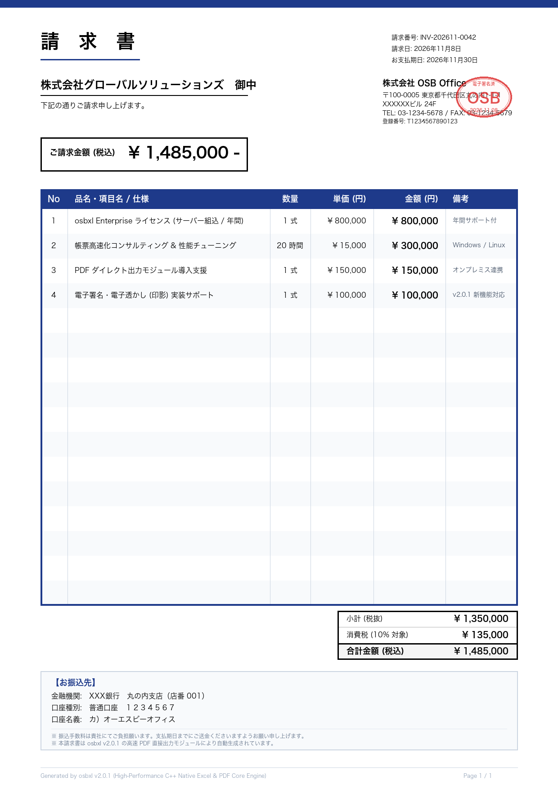

# osbxl-samples

> **Last Updated: November 8, 2026** (Reflecting latest osbxl `v2.0.1` benchmark measurements)  
> **[🇯🇵 日本語版の README はこちら (README.ja.md)](README.ja.md)**

Official verified code samples and patterns for **[osbxl (https://osb-office.com)](https://osb-office.com/)** — an AI-ready, ultra-fast C++ core multi-platform spreadsheet calculation and Excel generation engine.

[](https://osb-office.com/)
[](https://osb-office.com/en/pages/comparison.php)
[](https://osb-office.com/pages/ai-skill.php)
[](https://osb-office.com/pages/features.php)

---

## 📊 Comparison with Popular Excel Libraries

> 📈 **[New! Multi-Platform Benchmark Report (v2.0.1)](benchmarks/BENCHMARK_REPORT_3OS.en.md)**: Real-world stress testing across GCP C3/C4, macOS M4, and Windows 11. See how osbxl completes 50,000 rows in just 0.1s–0.5s where Apache POI and PhpSpreadsheet crash with OOM.
> 
> **For in-depth analysis and migration tips, check out our [Online Library Comparison Guide](https://osb-office.com/en/pages/comparison.php).**

Pure high-level libraries (Apache POI, openpyxl, PhpSpreadsheet) often suffer from **Out of Memory errors, GC pauses, and absent formula calculation engines** on large datasets. osbxl’s optimized C++ core eliminates these bottlenecks:

| Feature / Metric | **osbxl** | **Apache POI (Java)** | **openpyxl (Python)** | **PhpSpreadsheet (PHP)** | **SheetJS / ExcelJS (JS)** |
| :--- | :--- | :--- | :--- | :--- | :--- |
| **Core Engine** | **Native C++** | Java | Python | PHP | JavaScript |
| **Large-Scale Data Speed** | **◎ Blazing Fast** | ◯ (Streaming SXSSF) | △ (Slow on large sheets) | ✕ (Severely slow) | ◯ / △ |
| **Memory Footprint** | **◎ Ultra-low (Up to 90% less)** | △ (High heap usage) | △ (Object overhead) | ✕ (Frequent 500 crashes) | △ (V8 heap limit) |
| **Formula Calculation** | **~500 functions (XLOOKUP etc.)** | 300–400 functions | ✕ (Cannot evaluate) | △ (Partial & heavy) | Limited / Paid add-on |
| **AI Code Generation** | **◎ Official Skill Included** | None (High hallucination) | None | None | None |
| **WebAssembly** | **◎ Native Support (Wasm 3.0)** | ✕ | △ (Huge Pyodide runtime) | ✕ | ◯ |

---

## 🌟 Key Features

- **🤖 AI-Ready with Zero Hallucinations**: Bundled with official AI Skill packages tailored for **Cursor, GitHub Copilot, Gemini, and Claude Code**. AI generates verified, runnable Excel manipulation code on the first try.
- **⚡ Overwhelming C++ Speed**: Native C++ core engine processes large workbooks and complex formula calculations in milliseconds with minimal memory footprint.
- **🌐 5 Supported Platforms**: Consistent, clean APIs across **Python (pyosbxl)**, **Node.js (nodeosbxl)**, **Java (osbxl)**, **PHP (phposbxl)**, and **WebAssembly (wasmosbxl)**.
- **📊 Rich Spreadsheet Capabilities**: Nearly 500 Excel-compatible functions, charts (bar, line, etc.), AutoFilters, Tables (ListObjects), Conditional Formatting, and PivotTables.
- **🔒 Security**: Read and write password-protected, encrypted `.xlsx` workbooks.
- **📄 High-Speed Direct PDF Export (New in v2.0.0)**: Export directly to PDF or memory buffer (`saveAsPdf` / `saveAsPdfToBuffer`) without temporary files. Ideal for streaming PDF downloads directly in HTTP web APIs (Express, FastAPI, etc.).

---

## 📁 Repository Structure

```text
osbxl-samples/
├── README.md               # Overview and quick reference
├── README.ja.md            # 日本語版 README
├── LICENSE                 # Licenses (MIT for samples, OSBXL agreement for engine)
├── LICENSE.ja.md           # 日本語版ライセンス条項
├── examples/               # Standalone runnable code examples (Chapters 01–12 across all languages & zeroBase)
│   ├── nodejs/             # Node.js samples
│   │   ├── 01_overview.js ~ 12_pdf_export.js
│   │   ├── 13_express_pdf_stream.js  # [Featured] In-memory PDF streaming directly via Express HTTP POST
│   │   └── README.md                 # Express PDF streaming guide & curl testing instructions
│   ├── python/             # Python samples
│   │   ├── 01_overview.py ~ 12_pdf_export.py
│   │   ├── 13_fastapi_pdf_stream.py  # [Featured] In-memory PDF streaming directly via FastAPI HTTP POST
│   │   └── README.md                 # FastAPI PDF streaming guide & curl testing instructions
│   ├── php/                # PHP samples
│   │   ├── 01_overview.php ~ 12_pdf_export.php
│   │   ├── 13_slim_pdf_stream.php    # [Featured] In-memory PDF streaming directly via Slim 4 HTTP POST
│   │   └── README.md                 # Slim 4 PDF streaming guide & curl testing instructions
│   ├── java/               # Java samples
│   │   ├── General01Overview.java ~ General12PdfExport.java
│   │   ├── spring-boot-pdf/          # [Featured] In-memory PDF streaming directly via Spring Boot HTTP POST
│   │   └── README.md                 # Spring Boot PDF streaming guide & curl testing instructions
│   └── wasm/               # WebAssembly samples (01_overview.wasm.js ~ 12_pdf_export.wasm.js)
├── ja/                     # 日本語版 Web 形式リファレンス (general-01 ~ 12)
└── en/                     # English Web Reference (general-01 ~ 12)
```

### 🌟 Featured Real-World Samples: Direct In-Memory PDF Streaming via Web APIs (v2.0.1)

Practical examples of osbxl v2.0.1 **direct PDF streaming**.  
Without creating any temporary disk files, `wb.saveAsPdfToBuffer()` generates the PDF in memory and streams it directly through an HTTP POST response to the client.

- **Node.js (Express)**:
  - 👉 **[Express In-Memory PDF Streaming Guide & Usage (examples/nodejs/README.md)](examples/nodejs/README.md)**  
  - 👉 **Source Code: [`examples/nodejs/13_express_pdf_stream.js`](examples/nodejs/13_express_pdf_stream.js)**
- **Python (FastAPI)**:
  - 👉 **[FastAPI In-Memory PDF Streaming Guide & Usage (examples/python/README.md)](examples/python/README.md)**  
  - 👉 **Source Code: [`examples/python/13_fastapi_pdf_stream.py`](examples/python/13_fastapi_pdf_stream.py)**
- **PHP (Slim 4)**:
  - 👉 **[Slim 4 In-Memory PDF Streaming Guide & Usage (examples/php/README.md)](examples/php/README.md)**  
  - 👉 **Source Code: [`examples/php/13_slim_pdf_stream.php`](examples/php/13_slim_pdf_stream.php)**
- **Java (Spring Boot)**:
  - 👉 **[Spring Boot In-Memory PDF Streaming Guide & Usage (examples/java/README.md)](examples/java/README.md)**  
  - 👉 **Project: [`examples/java/spring-boot-pdf/`](examples/java/spring-boot-pdf/)**

---

## 📊 Feature Comparison Matrix & Real-world Benchmarks

**Last Updated: 2026-10-18**

A side-by-side comparison of advanced features (formula engine, PivotTables, charts, password encryption) and measured performance between popular open-source libraries and **osbxl**.

### 1. Feature Support Matrix

| Feature | osbxl (5 Languages) | Apache POI (Java) | openpyxl (Python) | PhpSpreadsheet (PHP) | ExcelJS / SheetJS (JS) |
|---|:---:|:---:|:---:|:---:|:---:|
| **.xlsx Read & Write** | **◎ Fast & Stable** | **◎** | **◎** | **◎** | **◎** |
| **Headless Formula Calculation**<br>(Evaluating values without Excel) | **◎ ~500 Functions**<br>(XLOOKUP, VLOOKUP, etc.) | **◯ 300–400 Functions**<br>(Evaluator) | **✕ Not Supported**<br>(None until Excel opens) | **△ Partial**<br>(Heavy & limited) | **✕ Not Supported**<br>(Requires paid SheetJS Pro) |
| **Tables & Structured References**<br>(e.g. `SUM(Table[Column])`) | **◎ Full Native Eval** | **△ No Calculation**<br>(Save only) | **✕ Cannot Eval** | **✕ Cannot Eval** | **✕ Cannot Eval** |
| **AutoFilter** | **◎ Advanced Filter** | **◯** | **◯** | **◯** | **◯** |
| **PivotTable Creation** | **◎ Standard API** | **◯ Low-level XML** | **△ Read-focused** | **✕ Not Supported** | **✕ Not Supported** |
| **Chart & Graph Generation** | **◎ 2D & 3D Charts** | **◯ Via XDDF** | **◯ 2D/3D Support** | **△ Limited rendering** | **✕–△ Minimal** |
| **Password Encryption / Decryption** | **◎ Built-in** | **◯ Standard** | **✕ Needs 3rd-party tool** | **✕ Needs extension** | **✕ Not Supported** |
| **Cell Comments (Notes & Threads)** | **◎ Both Notes & Threads** | **◯ Notes only** | **◯ Comments only** | **◯ Comments only** | **◯ Comments only** |
| **AI Codegen Optimization** | **◎ Official AI Skill**<br>(Zero hallucination) | **✕ Unofficial**<br>(Frequent fake APIs) | **✕ Unofficial** | **✕ Unofficial** | **✕ Unofficial** |

### 2. Standard 200-Row (800-Cell) Benchmark

Benchmark results generating a standard business report (**200 rows × 4 columns = 800 cells + SUM formula**).

| Language | Comparison | GCP C4: Rival OSS | GCP C4: **osbxl** | macOS: Rival OSS | macOS: **osbxl** | Speedup Factor |
| :--- | :--- | :---: | :---: | :---: | :---: | :---: |
| **PHP** (8.5) | PhpSpreadsheet vs **phposbxl** | 0.017 s | **0.007 s** | 0.018 s | **0.005 s** | **2.4x–3.5x faster** |
| **Python** (3.14) | openpyxl vs **pyosbxl** (`setOnlyMode`) | 0.011 s | **0.007 s** | 0.005 s | **0.003 s** | **~1.7x faster** |
| **Node.js** (v24) | ExcelJS vs **nodeosbxl** (`setOnlyMode`) | 0.011 s | **0.008 s** | 0.005 s | **0.004 s** | **1.3x–1.5x faster** |
| **Java** (JDK 24/8) | Apache POI vs **osbxl (Java)** | 0.542 s | **0.110 s** | 0.311 s | **0.057 s** | **4.9x–5.5x faster** |

### 3. Mid-Scale 10,000-Row (40,000-Cell) Benchmark

Benchmark results for standard business reporting (such as monthly logs, ledger exports) generating **10,000 rows × 4 columns = 40,000 cells + SUM formula**.

| Language | Comparison | GCP C4: Rival OSS | GCP C4: **osbxl** | macOS: Rival OSS | macOS: **osbxl** | Speedup Factor |
| :--- | :--- | :---: | :---: | :---: | :---: | :---: |
| **PHP** (8.5) | PhpSpreadsheet vs **phposbxl** | 0.760 s | **0.055 s** | 0.862 s | **0.037 s** | **13.9x–23.4x faster** |
| **Python** (3.14) | openpyxl vs **pyosbxl** (`setOnlyMode`) | 0.324 s | **0.058 s** | 0.166 s | **0.030 s** | **5.5x faster** |
| **Node.js** (v24) | ExcelJS vs **nodeosbxl** (`setOnlyMode`) | 0.239 s | **0.056 s** | 0.109 s | **0.028 s** | **3.9x–4.3x faster** |
| **Java** (JDK 24/8) | Apache POI vs **osbxl (Java)** | 1.335 s | **0.208 s** | 0.620 s | **0.098 s** | **6.3x–6.4x faster** |

### 4. Large-Scale 50,000-Row (200,000 Cells) Stress Test

Stress test results scaling data up to **50,000 rows × 4 columns = 200,000 cells + SUM formula**. While popular open-source libraries crash from out-of-memory errors, osbxl completes cleanly across all platforms in 0.1s–0.5s.

| Runtime / Limits | Comparison | GCP C4: Rival OSS | GCP C4: **osbxl** | macOS: Rival OSS | macOS: **osbxl** | Highlights & Fault Analysis |
| :--- | :--- | :---: | :---: | :---: | :---: | :--- |
| **PHP** (8.5 / 128M) | PhpSpreadsheet vs **phposbxl** | ❌ OOM Crash | **0.346 s** | ❌ OOM Crash | **0.189 s** | **PhpSpreadsheet crashes fatally** (`Allowed memory size exhausted`).<br>phposbxl runs safely in 0.1s–0.3s using only 32 MB. |
| **Python** (3.14) | openpyxl vs **pyosbxl** (`setOnlyMode`) | 1.662 s | **0.378 s** | 0.850 s | **0.183 s** | **4.39x faster on C4, 4.64x faster on M4**.<br>Python heap is only 28 MB with zero risk of OOM. |
| **Node.js** (v24) | ExcelJS vs **nodeosbxl** (`setOnlyMode`) | 0.979 s | **0.329 s** | 0.502 s | **0.133 s** | **2.97x faster on C4, 3.77x faster on M4**.<br>V8 heap capped at 20.9 MB, ideal for concurrent services. |
| **Java** (JDK 24/8 / 256M) | Apache POI vs **osbxl (Java)** | ❌ OOM Crash | **0.553 s** | ❌ OOM Crash | **0.247 s** | **POI crashes fatally** (`OutOfMemoryError: Java heap space`).<br>osbxl finishes cleanly in 0.2s–0.5s within 36.2 MB heap. |

> 💡 **Memory Structure & Language Heap Safety**:  
> ExcelJS and openpyxl keep every cell, row, and style as language-level objects in the runtime heap, rapidly consuming Node.js and Python heap limits (ExcelJS >420 MB, openpyxl >370 MB).<br>
> In contrast, osbxl transfers 2D matrix data immediately into the C++ core engine. **Node.js V8 heap usage remains at a modest 20.9 MB for 50,000 rows, and Python heap is only 28 MB**, entirely preventing language runtime OOM heap crashes. The process Peak RSS represents temporary native working buffers used by the C++ core for multi-threaded XML generation and ZIP compression.  
> 📖 **Full Feature Matrix & Detailed Analysis**: See [Excel Library Feature Comparison & Benchmark Report (en/benchmark-comparison.md)](en/benchmark-comparison.md).

---

## 🚀 Quick Code Examples (v2.0.1 Direct In-Memory PDF Streaming)

A premier feature of osbxl 2.0.1 is native **direct in-memory PDF streaming (`wb.saveAsPdfToBuffer`)**.  
Without creating temporary files on disk, binary data can be piped straight into HTTP responses across modern Web frameworks.  
*(For all language implementations and advanced options, please refer to **[Chapter 12: PDF Export (en/general-12-pdf-export.md)](en/general-12-pdf-export.md)**)*

### Node.js (Express)

```javascript
const express = require("express");
const { nodeosbxl, dto, enums } = require("nodeosbxl");

const app = express();

app.post("/api/export-pdf", (req, res) => {
    const xlApp = new nodeosbxl.App();
    const wb = xlApp.createWorkBook("report.xlsx");
    const ws = wb.openWorkSheet(0); // 0-based indexing (zeroBase)

    ws.getRange("A1").setValue("2026 Quarterly Performance Report");
    ws.getCells(1, 0).setValue("Quarter");
    ws.getCells(1, 1).setValue("Sales ($k)");
    ws.getCells(2, 0).setValue("Q1");
    ws.getCells(2, 1).setNumberValue(150);
    ws.getCells(3, 0).setValue("Q2");
    ws.getCells(3, 1).setNumberValue(230);
    ws.getCells(4, 0).setValue("Total");
    ws.getCells(4, 1).setFormula("SUM(B3:B4)");

    // A4 Landscape & centered
    const ps = ws.getPageSetupObject();
    ps.setPaperSize(enums.XlPaperSize.PaperA4);
    ps.setOrientation(enums.XlPageOrientation.Landscape);
    ps.setCenterHorizontally(true);
    ws.setPageSetupObject(ps);

    // PDF options (AES-256 open password & allow printing)
    const pdfOpt = new dto.PdfExportObject();
    pdfOpt.setOpenPassword("customer2026");
    pdfOpt.setAllowPrint(true);

    // Stream directly from memory buffer (zero disk writes)
    const pdfBuffer = wb.saveAsPdfToBuffer(false, ["Sheet1"], true, pdfOpt);
    wb.close();

    res.setHeader("Content-Type", "application/pdf");
    res.setHeader("Content-Disposition", 'attachment; filename="report.pdf"');
    res.send(pdfBuffer);
});

app.listen(3000);
```

### Python (FastAPI)

```python
from fastapi import FastAPI, Response
import pyosbxl
from pyosbxl import dto, enums

app = FastAPI()

@app.post("/api/export-pdf")
def export_pdf():
    xl_app = pyosbxl.App()
    wb = xl_app.createWorkBook("report.xlsx")
    ws = wb.openWorkSheet(0)  # 0-based indexing (zeroBase)

    ws.getRange("A1").setValue("2026 Quarterly Performance Report")
    ws.getCells(1, 0).setValue("Quarter")
    ws.getCells(1, 1).setValue("Sales ($k)")
    ws.getCells(2, 0).setValue("Q1")
    ws.getCells(2, 1).setNumberValue(150)
    ws.getCells(3, 0).setValue("Q2")
    ws.getCells(3, 1).setNumberValue(230)
    ws.getCells(4, 0).setValue("Total")
    ws.getCells(4, 1).setFormula("SUM(B3:B4)")

    ps = ws.getPageSetupObject()
    ps.setPaperSize(enums.XlPaperSize.PaperA4)
    ps.setOrientation(enums.XlPageOrientation.Landscape)
    ps.setCenterHorizontally(True)
    ws.setPageSetupObject(ps)

    pdf_opt = dto.PdfExportObject()
    pdf_opt.setOpenPassword("customer2026")
    pdf_opt.setAllowPrint(True)

    # Directly receive binary bytes from memory
    pdf_bytes = wb.saveAsPdfToBuffer(False, ["Sheet1"], True, pdf_opt)
    wb.close()

    return Response(
        content=pdf_bytes,
        media_type="application/pdf",
        headers={"Content-Disposition": 'attachment; filename="report.pdf"'}
    )
```

### PHP (Slim 4)

```php
use Psr\Http\Message\ResponseInterface as Response;
use Psr\Http\Message\ServerRequestInterface as Request;
use phposbxl\App;
use phposbxl\enums\XlPaperSize;
use phposbxl\enums\XlPageOrientation;
use phposbxl\dto\PdfExportObject;

$app->post('/api/export-pdf', function (Request $request, Response $response) {
    $xlApp = new App();
    $wb = $xlApp->createWorkBook("report.xlsx");
    $ws = $wb->openWorkSheet(0); // 0-based indexing (zeroBase)

    $ws->getRange("A1")->setValue("2026 Quarterly Performance Report");
    $ws->getCells(1, 0)->setValue("Quarter");
    $ws->getCells(1, 1)->setValue("Sales ($k)");
    $ws->getCells(2, 0)->setValue("Q1");
    $ws->getCells(2, 1)->setNumberValue(150);
    $ws->getCells(3, 0)->setValue("Q2");
    $ws->getCells(3, 1)->setNumberValue(230);
    $ws->getCells(4, 0)->setValue("Total");
    $ws->getCells(4, 1)->setFormula("SUM(B3:B4)");

    $ps = $ws->getPageSetupObject();
    $ps->setPaperSize(XlPaperSize::PaperA4);
    $ps->setOrientation(XlPageOrientation::Landscape);
    $ps->setCenterHorizontally(true);
    $ws->setPageSetupObject($ps);

    $pdfOpt = new PdfExportObject();
    $pdfOpt->setOpenPassword("customer2026");

    $pdfData = $wb->saveAsPdfToBuffer(false, ["Sheet1"], true, $pdfOpt);
    $wb->close();

    $response->getBody()->write($pdfData);
    return $response
        ->withHeader('Content-Type', 'application/pdf')
        ->withHeader('Content-Disposition', 'attachment; filename="report.pdf"');
});
```

### Java (Spring Boot)

```java
@RestController
public class PdfController {

    @PostMapping("/api/export-pdf")
    public ResponseEntity<byte[]> exportPdf() {
        AppWrapper app = new AppWrapper();
        WorkBookWrapper wb = app.createWorkBook("report.xlsx");
        WorkSheetWrapper ws = wb.openWorkSheet(0); // 0-based indexing (zeroBase)

        ws.getRange("A1").setValue("2026 Quarterly Performance Report");
        ws.getCells(1, 0).setValue("Quarter");
        ws.getCells(1, 1).setValue("Sales ($k)");
        ws.getCells(2, 0).setValue("Q1");
        ws.getCells(2, 1).setNumberValue(150);
        ws.getCells(3, 0).setValue("Q2");
        ws.getCells(3, 1).setNumberValue(230);
        ws.getCells(4, 0).setValue("Total");
        ws.getCells(4, 1).setFormula("SUM(B3:B4)");

        PageSetupObjectWrapper ps = ws.getPageSetupObject();
        ps.setPaperSize(XlPaperSize.PaperA4);
        ps.setOrientation(XlPageOrientation.Landscape);
        ps.setCenterHorizontally(true);
        ws.setPageSetupObject(ps);

        PdfExportObjectWrapper pdfOpt = new PdfExportObjectWrapper();
        pdfOpt.setOpenPassword("customer2026");

        byte[] pdfBytes = wb.saveAsPdfToBuffer(false, Collections.singletonList("Sheet1"), true, pdfOpt);
        wb.close();

        return ResponseEntity.ok()
                .contentType(MediaType.APPLICATION_PDF)
                .header(HttpHeaders.CONTENT_DISPOSITION, "attachment; filename=\"report.pdf\"")
                .body(pdfBytes);
    }
}
```

### 📷 Output PDF Preview

Actual rendered preview of the PDF (open password: `customer2026`) streamed directly from memory. The structured data table and clustered column chart are rendered cleanly side-by-side in A4 landscape:

[](assets/images/sales_report_pdf_preview.png)

#### 📄 Invoice PDF with Digital Watermark / Stamp (New in v2.0.1)

電子透かしを伴った、請求書の例です。

[](assets/images/invoice_pdf_watermark_preview.png)

👉 **For detailed implementation and options, see [Chapter 12: PDF Export (en/general-12-pdf-export.md)](en/general-12-pdf-export.md)**

---

## 🔗 Official Links & Documentation

- **Official Website**: [https://osb-office.com/](https://osb-office.com/)
- **Excel Library Performance & Features**: [https://osb-office.com/en/pages/comparison.php](https://osb-office.com/en/pages/comparison.php)
- **osbxl vs Famous Libraries Detailed Comparison (200 & 50,000 rows)**: [https://osb-office.com/en/pages/members/benchmark_report.php](https://osb-office.com/en/pages/members/benchmark_report.php)
- **Load Test Benchmark Report**: [https://osb-office.com/en/pages/members/tips.php](https://osb-office.com/en/pages/members/tips.php)
- **AI Skill Guide & Download**: [https://osb-office.com/pages/ai-skill.php](https://osb-office.com/pages/ai-skill.php)
- **Interactive Web Samples**: [https://osb-office.com/sample/](https://osb-office.com/sample/)
- **Product Features**: [https://osb-office.com/pages/features.php](https://osb-office.com/pages/features.php)
- **Free Demo Download**: [https://osb-office.com/pages/download.php](https://osb-office.com/pages/download.php)

---

## 📄 License

- **Sample Code & AI Skills**: [MIT License](LICENSE) — Feel free to use, copy, and modify in your projects.
- **OSBXL Engine (Libraries)**: Commercial / Proprietary by osb-office.inc. See [LICENSE](LICENSE) or [LICENSE.ja.md](LICENSE.ja.md) for software license agreement details.

